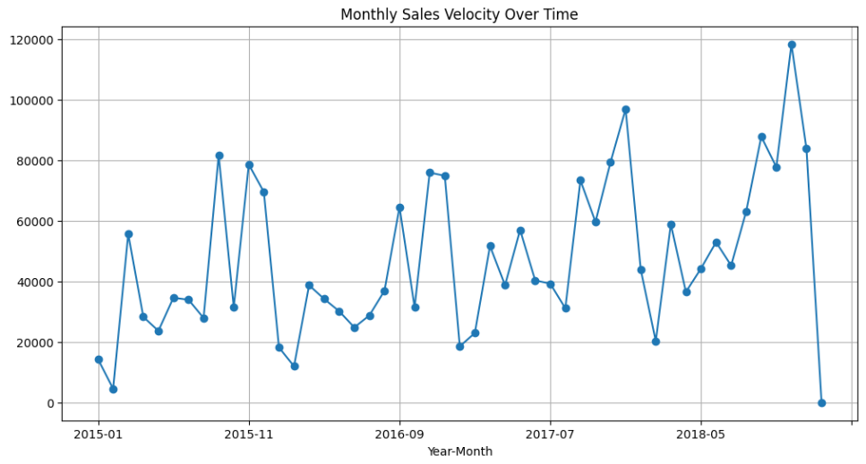
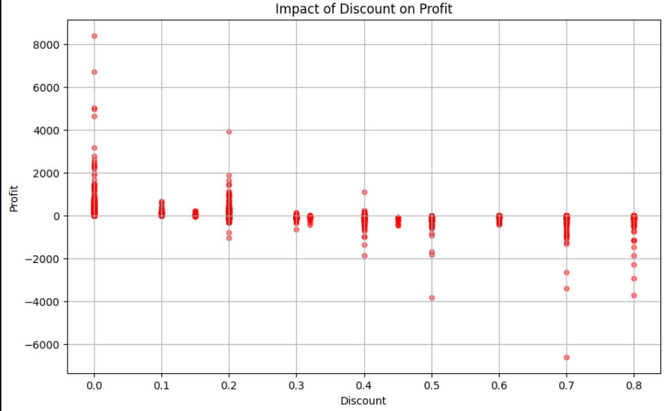

📊 Task 1 — Superstore Sales Analysis

🎯 Project Overview

This project focuses on analyzing Superstore sales data using Python and Pandas to identify sales trends, profitability patterns, regional performance, customer segment performance, and the impact of discounts on profit.

🛠️ Tools & Technologies

- Python
- Pandas
- Data Analysis
- Data Wrangling
- Data Visualization
- Jupyter Notebook

📌 Key Analysis

The project includes analysis of:

- Category-wise Sales and Profit
- Region-wise Sales and Profit
- Customer Segment Performance
- Monthly Sales Trends
- Discount vs. Profit Analysis

🔄 Data Processing

The dataset was cleaned and transformed using Pandas.

The `Order Date` column was converted into a datetime format and a new `Year-Month` column was created for monthly trend analysis.

A processed dataset was also generated after the data transformation.

📈 Visualizations

The project includes:

- Monthly Sales Velocity Line Chart
- Discount vs. Profit Scatter Plot

🔍 Key Insights

1. **Category Profitability:** Technology and Office Supplies generate strong profits, while Furniture has relatively lower profitability compared with its sales.

2. **Discount Impact:** Higher discount levels are associated with lower profitability, with aggressive discounts creating significant risk of negative profit.

3. **Regional Performance:** The West and East regions contribute strongly to overall sales and profitability.

4. **Customer Segments:** The Consumer segment contributes the largest share of sales compared with Corporate and Home Office segments.

5. **Sales Seasonality:** Monthly sales show stronger performance toward the end of the year, highlighting the importance of seasonal planning.

📂 Project Files

- `Datheon Task (1).ipynb` — Python analysis notebook
- `superstore_sales.csv` — Dataset

📚 Learning Outcomes

Through this project, I practiced:

- Loading and working with CSV datasets
- Data cleaning and transformation
- GroupBy aggregation
- Date/time data processing
- Sales and profitability analysis
- Data visualization using Pandas
- Extracting business insights from data
- Data cleaning and transformation
- GroupBy aggregation
- Date/time data processing
- Sales and profitability analysis
- Data visualization using Pandas
- Extracting business insights from data

📸 Project Screenshots
📈 Monthly Sales Trend

💰 Discount vs Profit Analysis

